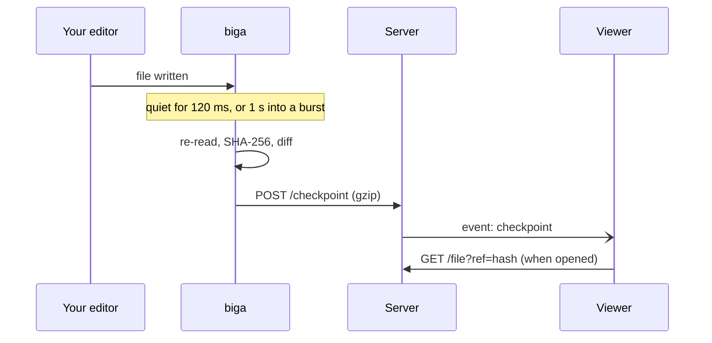

<div align="center">

# biga

**Stream your saves, not your screen.**

Broadcast a folder as a live, read-only link.<br>
No accounts, and nothing for viewers to install.

[](https://github.com/biga-sh/cli/releases/latest)
[](https://github.com/biga-sh/cli/actions/workflows/ci.yml)
[](LICENSE)

</div>

```text
$ biga start
┌  biga
◇  Started biga (k3f9zq2a) — uploaded 62 files, 254.6 KB
│
●  biga  https://your-server/session/k3f9zq2a
│  live · 2 checkpoints · 2 files · 2.2 KB sent · last sync just now
│  14:02:11  ~ internal/config/config.go
│  14:02:38  ~ README.md
│
c copy link · o open in browser · q stop
```

Send the link. Anyone who opens it gets the file tree, syntax highlighting and
a timeline, and follows every save as it happens. A screen share sends pixels;
biga sends the files themselves, so viewers can select, search and scroll at
their own pace.

## Install

| | |
| --- | --- |
| **macOS, Linux, FreeBSD** | `curl -fsSL https://raw.githubusercontent.com/biga-sh/cli/main/install.sh \| sh` |
| **Windows** (PowerShell) | `irm https://raw.githubusercontent.com/biga-sh/cli/main/install.ps1 \| iex` |
| **Go** 1.26 or newer | `go install github.com/biga-sh/cli/cmd/biga@latest` |

The scripts pick the right build for your OS and CPU and verify it against the
release's signed `checksums.txt`. Prefer a package? Releases include `.deb`,
`.rpm`, `.apk` and Arch packages, and plain archives for Linux (x64, arm64,
armv7), macOS (universal), Windows (x64, arm64) and FreeBSD (x64, arm64).

<details>
<summary>Install options and verifying a download</summary>

The scripts install to `~/.local/bin` (Windows: `%LOCALAPPDATA%\Programs\biga`,
added to your `PATH`). Set `BIGA_VERSION` to pin a version and
`BIGA_INSTALL_DIR` to choose the directory.

`checksums.txt` is signed with [Sigstore](https://www.sigstore.dev) by the
release workflow, so a valid signature proves the files were built by this
repository's CI from the tagged commit:

```sh
cosign verify-blob \
  --certificate-identity "https://github.com/biga-sh/cli/.github/workflows/release.yml@refs/tags/v1.0.0" \
  --certificate-oidc-issuer https://token.actions.githubusercontent.com \
  --bundle checksums.txt.sigstore.json checksums.txt
sha256sum --check --ignore-missing checksums.txt
```

Or check one file's build provenance with the GitHub CLI:

```sh
gh attestation verify biga_1.0.0_linux_amd64.tar.gz --repo biga-sh/cli
```

Every archive ships with an SBOM (`*.sbom.json`).

</details>

## Quick start

```sh
cd my-project
biga start
```

Press <kbd>c</kbd> to copy the link, <kbd>o</kbd> to open it, <kbd>q</kbd> to
stop. Run `biga start` in the same folder later and it **rejoins** the same
link, uploading only what changed.

By default biga talks to `http://localhost:3000`, a local copy of
[the site](https://github.com/biga-sh/website) and
[server](https://github.com/biga-sh/server). Point it at a hosted one to get
a link people outside your machine can open:

```sh
BIGA_API_URL=https://biga.example.com biga start
```

A self-hosted server ([biga-sh/docker](https://github.com/biga-sh/docker))
can require an access key; its operator gives you one:

```sh
BIGA_API_URL=https://biga.example.com BIGA_ACCESS_KEY=bgk_… biga start
```

## Commands

```text
biga start  [dir...] [--dir <path>]... [--title <text>] [--session <id>] [--open]
biga status [dir] [--json]
biga list   [--json]
biga open   [dir]
biga stop   [dir] [--all]
```

| Command | Does |
| --- | --- |
| `start` | Broadcasts directories and streams every saved change until stopped. Several start in parallel, one session each. |
| `status` | Shows a directory's link, when it started and last synced, and whether it is live. |
| `list` | Lists every session the CLI knows about. |
| `open` | Opens a directory's link in your browser. |
| `stop` | Asks a running broadcast, even one in another terminal, to send its final changes and end. |

Run `biga` with no command in a terminal to pick one interactively, and
`biga <command> --help` for flags. `--api-url` is accepted by every command.

## What gets shared

Everything under the directory **except**:

- paths matched by any `.gitignore` (at any depth), `.git/info/exclude` or your
  global excludes file, with git's precedence rules
- paths matched by any `.bigaignore`, which uses the same syntax for rules that
  apply only to broadcasting
- `node_modules/`, `.git/` and `.DS_Store`
- credentials: `.env` and `.env.*` (but not `.env.example`, `.env.sample` or
  `.env.template`), `*.pem`, `*.key`, `*.p12`, `*.pfx`, SSH keys (`id_rsa*`,
  `id_ed25519*` and friends), `.npmrc`, `.pypirc`, `.netrc`, and the `.ssh/`,
  `.aws/` and `.gnupg/` directories
- symlinks and special files

Re-include a default exclusion with `!name` in a `.bigaignore`. Editing an
ignore file while broadcasting takes effect immediately.

Build output folders (`dist`, `.next`, `build`, `out`, `coverage`, `.build`)
appear as empty folders; their contents are never read. Binary files and files
over 2 MB appear in the tree, but their contents are not uploaded.

## Sessions and workspaces

`biga start` picks the session ID from `--session`, then the one saved for the
directory (which **rejoins** it), then a new random 8-character ID. On rejoin
local files are the source of truth: the CLI compares them with the server's
copy and uploads only the difference, so a crash, a server restart or a dropped
connection is fixed by running the same command again. Changes made while the
server is unreachable are buffered and sent when it comes back.

Only the machine that created a session can change it. The server issues an
owner token when the session is created and keeps only a hash; the CLI saves
the token in `~/.biga/sessions.json` (readable by you only) and sends it with
every upload. Anyone with the link can watch, but nobody else can write to it.
If the token is lost, the next `biga start` gets a new session and link.

To broadcast several projects together, list them in a `biga.json`:

```json
{
  "projects": [
    { "dir": "backend", "title": "API" },
    { "dir": "frontend" }
  ]
}
```

Each project gets its own session, linked on the server as one workspace. The
CLI adds a generated `workspaceId` on first use so the link stays stable;
commit it. Directories passed on the command line take precedence.

## How it works



A watcher reports paths that may have changed, and content hashes decide what
actually did. A burst of saves goes out as one checkpoint, and a save that
changes nothing sends nothing. Uploads are gzip-compressed when the server
supports it, which typically cuts source code to a third, and large change
sets are split across several checkpoints. More diagrams are in the
[architecture docs](https://github.com/biga-sh/website/blob/main/apps/web/content/docs/architecture.mdx).

## Configuration

| Variable | Default | Description |
| --- | --- | --- |
| `BIGA_API_URL` | `http://localhost:3000` | Server base URL. `--api-url` overrides it. |
| `BIGA_ACCESS_KEY` | unset | Access key for servers that only accept broadcasts from key holders. |
| `BIGA_HOME` | `~/.biga` | Where local state is kept. |
| `BIGA_IDLE_MS` | `120` | Quiet time after the last change before a checkpoint is sent. |
| `BIGA_MAX_WAIT_MS` | `1000` | Longest a burst of changes can delay a checkpoint. |
| `BIGA_STABILITY_MS` | `75` | How long a file must stop changing before it is read. |
| `BIGA_HEARTBEAT_MS` | `10000` | How often a broadcast tells the server it is live. |
| `BIGA_NO_UPDATE_CHECK` | unset | Set to anything to skip the daily release check. |

Raise the timing values on slow disks or filesystems that report partial
writes; lower them for snappier updates. Local state lives in `~/.biga`:
`sessions.json` (each directory's session, which keeps links stable),
`control/` (stop requests) and `update-check.json`.

## Contributing

Issues and pull requests are welcome. See [CONTRIBUTING.md](CONTRIBUTING.md)
for building, testing and releasing.

## License

[MIT](LICENSE)
